# 1 — Use Case Diagram

**Rubric: 4 marks — appropriate actors, use cases and relationships.**

---

## 1.1 The diagram

```mermaid
flowchart TB
    Admin(["Administrator"])
    Adviser(["Adviser"])
    Student(["Student"])

    subgraph SCAIS["SCAIS - Smart Course Advising Information System"]
        direction LR

        subgraph Shared["All roles"]
            direction TB
            UC01(["UC-01 Log in"])
            UC02(["UC-02 Redirect to role dashboard"])
            UC20(["UC-20 Authenticate user"])
        end

        subgraph AdminUC["Administrator functions"]
            direction TB
            UC03(["UC-03 Manage user accounts"])
            UC04(["UC-04 Maintain course catalogue"])
            UC05(["UC-05 Define prerequisite and corequisite rules"])
            UC06(["UC-06 Assign advisees to advisers"])
            UC07(["UC-07 Define course offerings per semester"])
            UC16(["UC-16 Generate course progression report"])
            UC17(["UC-17 Generate prerequisite compliance report"])
        end

        subgraph AdviserUC["Adviser functions"]
            direction TB
            UC12(["UC-12 View assigned advisees"])
            UC13(["UC-13 Access advisee history and specialization"])
            UC14(["UC-14 Recommend courses based on eligibility"])
            UC15(["UC-15 Approve or modify a course plan"])
        end

        subgraph StudentUC["Student functions"]
            direction TB
            UC08(["UC-08 View academic record and course status"])
            UC09(["UC-09 View eligible courses"])
            UC10(["UC-10 Submit preferred courses for review"])
            UC11(["UC-11 View approved courses and remarks"])
            UC21(["UC-21 View own messages"])
        end

        subgraph SystemUC["System functions"]
            direction TB
            UC18(["UC-18 Validate prerequisites and corequisites"])
            UC19(["UC-19 Notify student of a decision"])
        end
    end

    Admin --> UC01
    Admin --> UC03
    Admin --> UC04
    Admin --> UC05
    Admin --> UC06
    Admin --> UC07
    Admin --> UC16
    Admin --> UC17

    Adviser --> UC01
    Adviser --> UC12
    Adviser --> UC13
    Adviser --> UC14
    Adviser --> UC15
    Adviser --> UC16

    Student --> UC01
    Student --> UC08
    Student --> UC09
    Student --> UC10
    Student --> UC11
    Student --> UC21

    UC01 -.->|"include"| UC20
    UC01 -.->|"include"| UC02
    UC09 -.->|"include"| UC18
    UC10 -.->|"include"| UC18
    UC14 -.->|"include"| UC18
    UC15 -.->|"extend"| UC19
    UC15 -.->|"extend"| UC11
```

> **Note for EA.** Mermaid has no native use case diagram, so the block above uses a
> flowchart with stadium shapes for the use cases and subgraphs to group them. In EA,
> draw this as a proper **Use Case** diagram: actors as stick figures outside a system
> boundary rectangle, use cases as ellipses inside it, and `«include»` / `«extend»` as
> dependency arrows. The grouping above is only a layout aid; in EA the use cases all sit
> directly inside the one boundary.

---

## 1.2 Actors

| Actor | Type | Description |
|---|---|---|
| **Administrator** | Human, primary | Maintains the course catalogue, the curriculum rules, the user accounts and the adviser assignments |
| **Adviser** | Human, primary | Faculty member who manages assigned advisees and approves their course plans |
| **Student** | Human, primary | IT student with a declared specialization who plans and requests courses |

No secondary or system actor is drawn separately. The two system-side behaviours that
would otherwise be separate actors — authentication and eligibility validation — are
modelled as **included** use cases instead, because the system performs them on behalf of
a primary actor rather than on its own behalf.

**Counts for the report: 3 actors, 21 use cases.**

---

## 1.3 Use case catalogue

| ID | Use case | Actor | Priority | Where it is implemented |
|---|---|---|---|---|
| UC-01 | Log in | All | Must | `UI/frmLogin.cs` |
| UC-02 | Redirect to role dashboard | System | Must | `UI/DashboardFactory.cs` |
| UC-03 | Manage user accounts | Administrator | Must | `UI/frmUserManagement.cs` |
| UC-04 | Maintain course catalogue | Administrator | Must | `UI/frmCourseCatalog.cs` — Courses tab |
| UC-05 | Define prerequisite and corequisite rules | Administrator | Must | `UI/frmCourseCatalog.cs` — Rules tab |
| UC-06 | Assign advisees to advisers | Administrator | Must | `UI/frmAssignAdvisees.cs` |
| UC-07 | Define course offerings per semester | Administrator | Should | `DataAccess/CourseRepository.cs` |
| UC-08 | View academic record and course status | Student | Must | `UI/frmMyAcademicRecord.cs` — My record tab |
| UC-09 | View eligible courses | Student | Must | `UI/frmMyAcademicRecord.cs` — Eligible tab |
| UC-10 | Submit preferred courses for review | Student | Must | `UI/frmMyAcademicRecord.cs` — Eligible tab |
| UC-11 | View approved courses and remarks | Student | Must | `UI/frmMyAcademicRecord.cs` — My requests tab |
| UC-12 | View assigned advisees | Adviser | Must | `UI/frmAdviseeList.cs` |
| UC-13 | Access advisee history and specialization | Adviser | Must | `UI/frmAdviseeList.cs` |
| UC-14 | Recommend courses based on eligibility | Adviser | Must | `UI/frmAdviseeList.cs` |
| UC-15 | Approve or modify a course plan | Adviser | Must | `UI/frmCourseRequestReview.cs` |
| UC-16 | Generate course progression report | Adviser, Administrator | Must | `UI/frmReports.cs` |
| UC-17 | Generate prerequisite compliance report | Administrator | Should | `UI/frmReports.cs` |
| UC-18 | Validate prerequisites and corequisites | System | Must | `Business/EligibilityValidator.cs` |
| UC-19 | Notify student of a decision | System | Should | `Observers/StudentNotificationService.cs` |
| UC-20 | Authenticate user | System | Must | `Business/AuthenticationService.cs` |
| UC-21 | View own messages | Student | Should | `UI/frmMessages.cs` |

Every use case above maps to a screen or a class that exists in the delivered
application, which is what makes the use case diagram consistent with the class diagram
and with the running system.

---

## 1.4 Relationship justification

The rubric warns explicitly that relationships should not be invented, so each one is
present for a stated reason:

| Relationship | Why it is genuinely there |
|---|---|
| UC-01 **includes** UC-20 | Logging in always involves authenticating. The login cannot complete without it, so it is an inclusion and not an extension. |
| UC-01 **includes** UC-02 | Signing in always results in a redirect. The destination varies with the role, but the redirect itself always happens. |
| UC-09, UC-10, UC-14 **include** UC-18 | All three need the eligibility verdict before they can show or accept anything, and all three reuse the same validation instead of reimplementing it. This is the clearest justification in the model: one validation, three callers. |
| UC-15 **extends** UC-19 | A decision does not have to notify anybody in order to be valid. In this system it normally does, which is exactly what "optional behaviour that extends" means. |
| UC-15 **extends** UC-11 | Seeing the approved plan is a consequence of approval that the student may or may not then do. It is not part of the approval itself. |

No other relationships are drawn. In particular UC-03 to UC-07 are **not** related to
each other: they are independent maintenance operations that an administrator may perform
in any order, and connecting them would imply an ordering that does not exist.

---

## 1.5 EA redraw checklist

- [ ] Three actors as stick figures, all **outside** the system boundary
- [ ] A system boundary rectangle labelled `SCAIS`
- [ ] All 21 use cases as ellipses **inside** the boundary
- [ ] Association lines from each actor to the use cases listed in §1.3
- [ ] `«include»` on the four inclusions listed in §1.4
- [ ] `«extend»` on the two extensions listed in §1.4
- [ ] Every use case has at least one actor, and every actor has at least one use case
- [ ] Arrows point the correct way: an `«include»` arrow points **from** the including
      use case **to** the included one, and an `«extend»` arrow points **from** the
      extending use case **to** the one it extends

