# 2 — Class Diagram

**Rubric: 15 marks — classes, attributes, methods, relationships and multiplicity.**

This is the largest single item in the rubric. The diagram is split into two views of the
same model so that each is readable; in Enterprise Architect they belong in one diagram
(or in two packages of one model), and the report should show both.

Every name, attribute and operation below is taken from the delivered code in
`src/SCAIS/SCAIS/Domain`.

---

## 2.1 The domain model

```mermaid
classDiagram
    direction TB

    class User {
        <<abstract>>
        -userId int
        -username string
        -passwordHash string
        -fullName string
        -email string
        -isActive bool
        -role UserRole
        +UserId int
        +Username string
        +Role UserRole
        +FullName string
        +Email string
        +IsActive bool
        +GetProfileSummary() string
        +GetDashboardTitle() string
        +CanApproveCourseRequests bool
        +Authenticate(plainPassword) bool
        +SetPassword(plainPassword) void
    }

    class Student {
        -studentId int
        -enrollmentYear int
        -gpa decimal
        -enrollments List~Enrollment~
        +StudentId int
        +EnrollmentYear int
        +GPA decimal
        +Specialization Specialization
        +Adviser Adviser
        +Enrollments IList~Enrollment~
        +LoadAcademicRecord(record) void
        +HasCompleted(courseId) bool
        +HasTakenOrIsTaking(courseId) bool
        +GetCompletedCourses() IEnumerable~Enrollment~
        +GetInProgressCourses() IEnumerable~Enrollment~
        +GetPendingCourses() IEnumerable~Enrollment~
        +GetCreditsForSemester(semesterId) int
        +GetEarnedCredits() int
    }

    class Adviser {
        -adviserId int
        -department string
        -office string
        -advisees List~Student~
        +AdviserId int
        +Department string
        +Office string
        +Advisees IList~Student~
        +AssignAdvisee(student) void
        +RemoveAdvisee(student) bool
        +GetAdviseeCount() int
    }

    class Administrator {
        -adminId int
        -accessLevel string
        +AdminId int
        +AccessLevel string
        +CanManageUsers bool
        +CanManageCatalogue bool
    }

    class Specialization {
        -specializationId int
        -name string
        -description string
        +SpecializationId int
        +Name string
        +Description string
    }

    class Course {
        -courseId int
        -code string
        -title string
        -creditHours int
        -isCore bool
        -description string
        +MinimumCreditHours int
        +MaximumCreditHours int
        +CourseId int
        +Code string
        +Title string
        +CreditHours int
        +IsCore bool
        +Description string
        +Specialization Specialization
        +GetDisplayName() string
        +IsCoreSubject() bool
    }

    class Prerequisite {
        -prerequisiteId int
        -ruleType RuleType
        +PrerequisiteId int
        +Course Course
        +RequiredCourse Course
        +RuleType RuleType
        +IsPrerequisite() bool
        +IsCorequisite() bool
        +GetDescription() string
    }

    class Enrollment {
        -enrollmentId int
        -studentId int
        -semesterId int
        -status EnrollmentStatus
        -grade string
        +EnrollmentId int
        +StudentId int
        +SemesterId int
        +Course Course
        +Status EnrollmentStatus
        +Grade string
        +MarkCompleted(grade) void
        +MarkInProgress() void
        +MarkPending() void
        +IsCompleted() bool
        +IsInProgress() bool
        +IsPending() bool
        +HasPassed() bool
        +GetStatusText() string
    }

    class CourseRequest {
        -requestId int
        -studentId int
        -semesterId int
        -adviserId int
        -status RequestStatus
        -submittedDate DateTime
        -adviserRemark string
        -lines List~CourseRequestLine~
        -observers List~IUserObserver~
        +RequestId int
        +StudentId int
        +SemesterId int
        +AdviserId int
        +Status RequestStatus
        +SubmittedDate DateTime
        +AdviserRemark string
        +Lines IList~CourseRequestLine~
        +AddCourse(course, eligibilityNote) CourseRequestLine
        +GetCourseCount() int
        +GetTotalCreditHours() int
        +ContainsBlockedCourse() bool
        +Attach(observer) void
        +Detach(observer) bool
        +GetObserverCount() int
        +Submit() void
        +Approve(remark) void
        +Reject(remark) void
    }

    class CourseRequestLine {
        -lineId int
        -requestId int
        -eligibilityNote string
        +BlockedPrefix string
        +LineId int
        +RequestId int
        +Course Course
        +EligibilityNote string
        +IsEligible bool
        +SetEligibilityNote(note) void
    }

    class Semester {
        -semesterId int
        -termName string
        -academicYear int
        -startDate DateTime
        -endDate DateTime
        +SemesterId int
        +TermName string
        +AcademicYear int
        +StartDate DateTime
        +EndDate DateTime
        +GetDisplayName() string
    }

    class CourseOffering {
        -offeringId int
        -capacity int
        -enrolled int
        +OfferingId int
        +Course Course
        +Semester Semester
        +Capacity int
        +Enrolled int
        +SeatsRemaining int
        +HasSpace() bool
        +HasEnrollments() bool
        +GetDisplayName() string
        +GetAvailabilityText() string
    }

    class Notification {
        -notificationId int
        -userId int
        -message string
        -createdDate DateTime
        -isRead bool
        +NotificationId int
        +UserId int
        +Message string
        +CreatedDate DateTime
        +IsRead bool
        +MarkAsRead() void
    }

    class EligibilityResult {
        -isEligible bool
        -reason string
        +BlockedPrefix string
        +IsEligible bool
        +Reason string
        +Pass(ruleName)$ EligibilityResult
        +Fail(ruleName, detail)$ EligibilityResult
    }

    class IUserObserver {
        <<interface>>
        +OnRequestStatusChanged(request, newStatus) void
    }

    User <|-- Student
    User <|-- Adviser
    User <|-- Administrator

    Adviser "1" o-- "0..*" Student : advises
    Student "0..*" --> "1" Specialization : declares
    Specialization "1" o-- "0..*" Course : groups
    Student "1" --> "0..*" Enrollment : has record
    Enrollment "0..*" --> "1" Course : studies
    Enrollment "0..*" --> "1" Semester : taken in
    Course "1" --> "0..*" CourseOffering : is offered as
    Semester "1" --> "0..*" CourseOffering : offers
    Course "1" --> "0..*" Prerequisite : is dependent in
    Prerequisite "0..*" --> "1" Course : requires
    Student "1" --> "0..*" CourseRequest : submits
    Adviser "1" --> "0..*" CourseRequest : reviews
    CourseRequest "0..*" --> "1" Semester : planned for
    CourseRequest "1" *-- "1..*" CourseRequestLine : contains
    CourseRequestLine "0..*" --> "1" Course : requests
    CourseRequest "1" --> "0..*" IUserObserver : notifies
```

---

## 2.2 Relationship summary and justification

The rubric says explicitly: *"Do not award marks simply because students have included
every type of relationship. The relationship must be appropriate to the problem domain."*
Every relationship below is therefore stated with its reason.

| From | → | To | Type | Multiplicity | Why this relationship, and this type |
|---|---|---|---|---|---|
| `User` | ◁— | `Student`, `Adviser`, `Administrator` | **Inheritance** | — | A genuine is-a: every adviser **is a** user of SCAIS and signs in through the same screen. Identity and authentication are implemented once in the parent; the dashboard, profile summary and approval capability are specialised in the children. |
| `Adviser` | ◇— | `Student` | **Aggregation** | `1 — 0..*` | A student exists independently of the adviser and the assignment is made and changed by an administrator. The adviser does not own the student, so this is an aggregation and not a composition. |
| `Student` | — | `Specialization` | Association | `* — 1` | Every student declares exactly one track. |
| `Specialization` | ◇— | `Course` | **Aggregation** | `1 — 0..*` | A track groups the subjects that belong to it, but a core subject belongs to every track and a course exists independently of any single track. |
| `Student` | — | `Enrollment` | Association | `1 — 0..*` | The academic record: one entry per course the student has any status for. |
| `Enrollment` | — | `Course` | Association | `* — 1` | Each entry is about one course. |
| `Course` | — | `CourseOffering` | Association | `1 — 0..*` | A course may run in many terms. The offering carries the term-specific fact (the places available); the course itself is term-independent, which is why the catalogue and the timetable are separate. |
| `Semester` | — | `CourseOffering` | Association | `1 — 0..*` | One term contains many offerings. With the row above, this is the timetable an administrator maintains under UC-07, and it is why `CourseOffering` is the only class that needs both a `Course` and a `Semester`. |
| `Enrollment` | — | `Semester` | Association | `* — 1` | Each entry was taken in one term. |
| `Course` | — | `Prerequisite` | Association | `1 — 0..*` | A course may be governed by several rules. |
| `Prerequisite` | — | `Course` | Association | `* — 1` | A rule names the course that must be completed first. Together with the row above this is a **many-to-many self relationship on `Course`**, which is why the class appears on both ends. |
| `Student` | — | `CourseRequest` | Association | `1 — 0..*` | A student submits many plans over time. |
| `Adviser` | — | `CourseRequest` | Association | `1 — 0..*` | A plan is reviewed by the adviser assigned to the student. |
| `CourseRequest` | — | `Semester` | Association | `* — 1` | A plan is always for exactly one term. |
| `CourseRequest` | ◆— | `CourseRequestLine` | **Composition** | `1 — 1..*` | A line has no identity or lifetime of its own: it cannot be moved to another plan, and deleting the plan must delete its lines. The database expresses the same rule with `ON DELETE CASCADE`. |
| `CourseRequestLine` | — | `Course` | Association | `* — 1` | Each line asks for one course. |
| `CourseRequest` | — | `IUserObserver` | Association | `1 — 0..*` | The subject holds a list of observers, which is the structure the Observer pattern requires. |

### Relationships deliberately **not** drawn

The rubric rewards avoiding unnecessary relationships, so it is worth stating what was
left out and why:

| Not drawn | Why not |
|---|---|
| `Administrator` → `Course`, `Student`, `User` | An administrator *maintains* these, but maintenance is a behaviour performed through a service, not a structural relationship the object holds. Drawing it would have implied that an administrator owns the catalogue. |
| `Student` → `Prerequisite` | A student has no relationship with a rule. The rule is between two courses, and the student is only affected by it at the moment eligibility is evaluated. |
| `Semester` → `Course` | There is no direct relationship. The two are connected through `CourseOffering`, which is the timetable, and through `Enrollment`, which is the academic record. A direct link would have claimed that a course belongs to one term, which is false: the catalogue outlives every term. |
| `Notification` → `CourseRequest` | A notification is produced by a status change but does not reference the plan; it only carries text addressed to a user. Adding the link would have forced the notification to hold a plan it does not use. |
| `User` → `Notification` as a collection | A user's messages are read on demand rather than held in memory. Holding them would have loaded every message of every account whenever a user was loaded. |

---

## 2.3 The services, interfaces and data layer

The second view of the same model. It shows how the domain classes of §2.1 are reached:
through interfaces, so that the screens never talk to a repository or a rule directly.

```mermaid
classDiagram
    direction TB

    class IRepository~T~ {
        <<interface>>
        +GetById(id) T
        +GetAll() List~T~
        +Add(entity) bool
        +Update(entity) bool
        +Delete(id) bool
    }

    class IEligibilityRule {
        <<interface>>
        +RuleName string
        +Evaluate(student, course) EligibilityResult
    }

    class IUserObserver {
        <<interface>>
        +OnRequestStatusChanged(request, newStatus) void
    }

    class SqlRepositoryBase~T~ {
        <<abstract>>
        #CreateConnection() SqlConnection
        #Query~TResult~(sql, map, parameters) List~TResult~
        #Execute(sql, parameters) int
        #ExecuteInsert(sql, parameters) int
    }

    class UserRepository
    class CourseRepository
    class PrerequisiteRepository
    class EnrollmentRepository
    class CourseRequestRepository
    class NotificationRepository
    class SpecializationRepository
    class SemesterRepository
    class CourseOfferingRepository

    class DatabaseManager {
        <<Singleton>>
        -instance DatabaseManager
        -connectionString string
        -DatabaseManager() void
        +Instance DatabaseManager
        +CreateConnection() SqlConnection
        +EnsureDatabase() void
    }

    class PrerequisiteRule {
        +RuleName string
        +Evaluate(student, course) EligibilityResult
    }

    class CorequisiteRule {
        +RuleName string
        +Evaluate(student, course) EligibilityResult
    }

    class CreditLimitRule {
        +MaximumCredits int
        +Evaluate(student, course) EligibilityResult
    }

    class AlreadyCompletedRule {
        +RuleName string
        +Evaluate(student, course) EligibilityResult
    }

    class SpecializationRule {
        +RuleName string
        +Evaluate(student, course) EligibilityResult
    }

    class EligibilityValidator {
        -rules List~IEligibilityRule~
        +Rules IList~IEligibilityRule~
        +CreateDefaultRules()$ List~IEligibilityRule~
        +Validate(student, course) EligibilityResult
        +ValidateCatalogue(student, courses) List~CourseEligibility~
    }

    class StudentNotificationService {
        +OnRequestStatusChanged(request, newStatus) void
    }

    class AuditLogService {
        +OnRequestStatusChanged(request, newStatus) void
    }

    class AuthenticationService {
        -repository UserRepository
        +Login(username, password) LoginResult
        +ChangePassword(userId, current, newPassword) LoginResult
        +Logout() void
    }

    class CourseAdvisingService {
        +LoadStudent(studentId) Student
        +GetEligibleCourses(student) List~CourseEligibility~
        +CreateRequest(student, semesterId) CourseRequest
        +AddCourseToRequest(request, student, course) EligibilityResult
        +SubmitRequest(request) bool
        +ApproveRequest(request, remark) bool
        +RejectRequest(request, remark) bool
        -AttachObservers(request) void
        -CreateEnrollmentsForApprovedPlan(request) void
    }

    class ReportService {
        +GetCourseProgression(studentId) List~CourseProgressionRow~
        +GetPrerequisiteCompliance() List~PrerequisiteComplianceRow~
        +GetProgressionSummary(studentId) string
    }

    class SessionManager {
        <<static>>
        +CurrentUser User
        +SignIn(user) void
        +SignOut() void
    }

    class UserFactory {
        +Create(record) User
    }

    class UserRecord {
        +UserId int
        +Username string
        +Role UserRole
        +RoleRecordId int
    }

    SqlRepositoryBase~T~ ..|> IRepository~T~
    UserRepository --|> SqlRepositoryBase~T~
    CourseRepository --|> SqlRepositoryBase~T~
    PrerequisiteRepository --|> SqlRepositoryBase~T~
    EnrollmentRepository --|> SqlRepositoryBase~T~
    CourseRequestRepository --|> SqlRepositoryBase~T~
    NotificationRepository --|> SqlRepositoryBase~T~
    SpecializationRepository --|> SqlRepositoryBase~T~
    SemesterRepository --|> SqlRepositoryBase~T~

    PrerequisiteRule ..|> IEligibilityRule
    CorequisiteRule ..|> IEligibilityRule
    CreditLimitRule ..|> IEligibilityRule
    AlreadyCompletedRule ..|> IEligibilityRule
    SpecializationRule ..|> IEligibilityRule

    StudentNotificationService ..|> IUserObserver
    AuditLogService ..|> IUserObserver

    EligibilityValidator "1" o-- "1..*" IEligibilityRule : runs
    CourseAdvisingService --> EligibilityValidator : uses
    CourseAdvisingService --> CourseRequestRepository : uses
    CourseAdvisingService --> EnrollmentRepository : uses
    CourseAdvisingService --> StudentNotificationService : attaches
    CourseAdvisingService --> AuditLogService : attaches
    AuthenticationService --> UserRepository : uses
    AuthenticationService --> SessionManager : signs in
    ReportService --> EnrollmentRepository : uses
    ReportService --> PrerequisiteRepository : uses
    UserRepository ..> UserFactory : creates through
    UserFactory ..> UserRecord : reads
    SqlRepositoryBase~T~ ..> DatabaseManager : uses
```

---

## 2.4 EA redraw checklist

The class diagram is worth **15 marks**, more than any other single item, so this list is
the one to work through carefully.

### Visibility
- [ ] Every attribute has a visibility marker: `-` private, `#` protected, `+` public
- [ ] Every operation has a visibility marker
- [ ] `User` is marked `«abstract»` and is shown in *italics* if EA does so by default
- [ ] `SqlRepositoryBase<T>` is marked `«abstract»`
- [ ] `IRepository<T>`, `IEligibilityRule` and `IUserObserver` are marked `«interface»`
- [ ] `DatabaseManager` is marked `«Singleton»`

### Multiplicity — the most commonly lost marks
- [ ] Every association has a multiplicity on **both** ends
- [ ] `Adviser 1 — 0..* Student`
- [ ] `Student * — 1 Specialization`
- [ ] `Specialization 1 — 0..* Course`
- [ ] `Student 1 — 0..* Enrollment`
- [ ] `Enrollment * — 1 Course` and `Enrollment * — 1 Semester`
- [ ] `Course 1 — 0..* Prerequisite` and `Prerequisite * — 1 Course`
- [ ] `Student 1 — 0..* CourseRequest`
- [ ] `Adviser 1 — 0..* CourseRequest`
- [ ] `CourseRequest * — 1 Semester`
- [ ] `CourseRequest 1 — 1..* CourseRequestLine`
- [ ] `CourseRequestLine * — 1 Course`
- [ ] `Course 1 — 0..* CourseOffering` and `Semester 1 — 0..* CourseOffering`
- [ ] `CourseRequest 1 — 0..* IUserObserver`

### Relationship types
- [ ] One **inheritance** tree: `User` ← `Student`, `Adviser`, `Administrator`
- [ ] One **composition** with a filled diamond: `CourseRequest` ◆ `CourseRequestLine`
- [ ] One **aggregation** with a hollow diamond: `Adviser` ◇ `Student`
- [ ] A second **aggregation**: `Specialization` ◇ `Course`
- [ ] Three **interface realisations** with a dashed line and hollow triangle
- [ ] The many-to-many **self relationship** on `Course` through `Prerequisite` is visible
- [ ] No relationship is drawn that is not in the §2.2 table

### Operations and attributes
- [ ] `User.GetProfileSummary()`, `GetDashboardTitle()` and `CanApproveCourseRequests`
      are present — these are the polymorphism evidence
- [ ] `Enrollment.Status` and `Enrollment.Grade` are shown as **get-only**, with
      `MarkCompleted`, `MarkInProgress` and `MarkPending` as the only mutators
- [ ] `CourseRequest.Submit`, `Approve` and `Reject` are present
- [ ] `EligibilityValidator.Validate` and `ValidateCatalogue` are present

### Layout
- [ ] The `User` hierarchy is at the top and the three subclasses are on one level
- [ ] `CourseRequest` and `CourseRequestLine` are adjacent so the composition is obvious
- [ ] The diagram is legible at the size it will be printed — if not, print it on its own
      page in landscape
