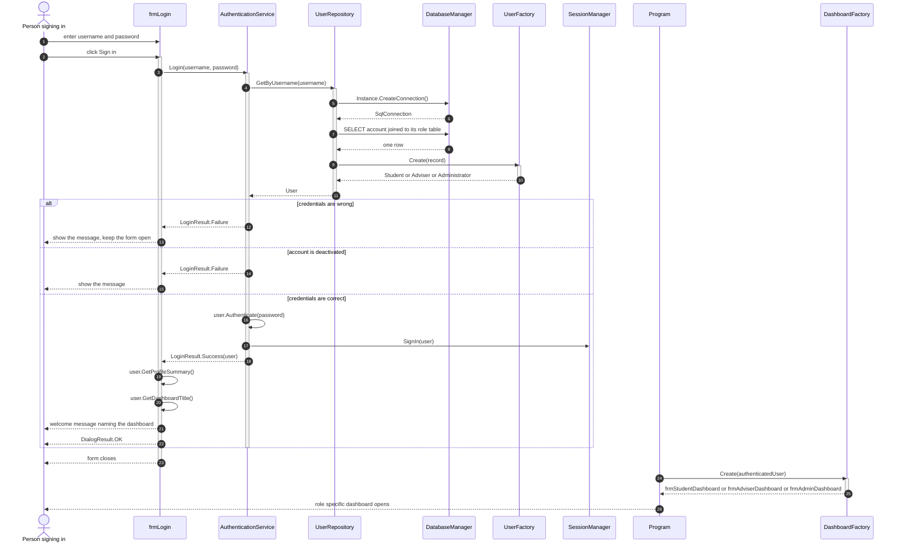
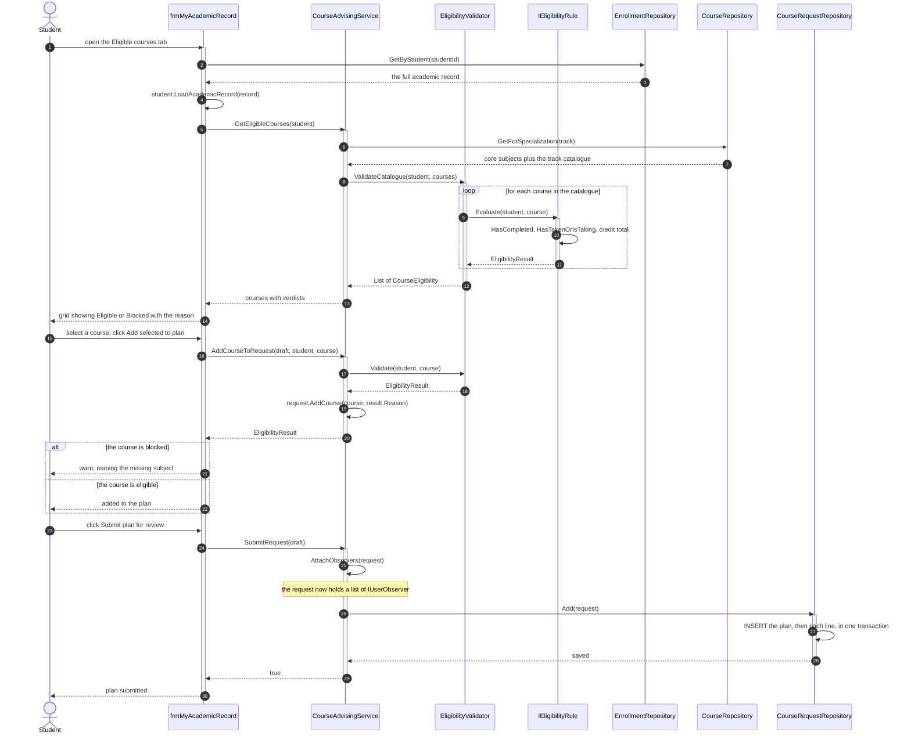
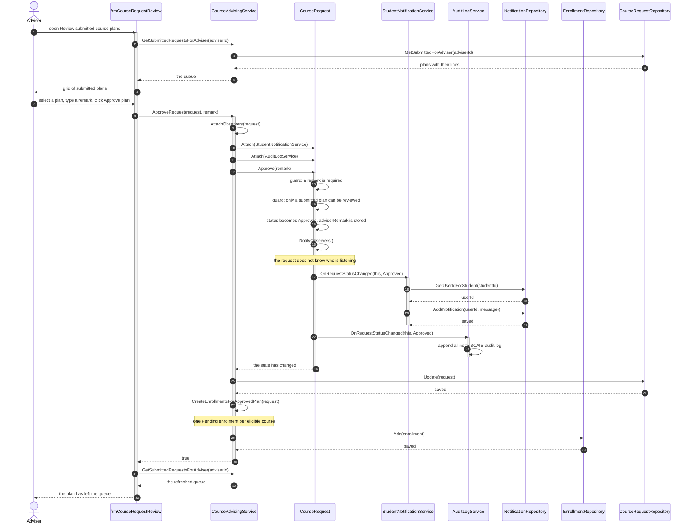
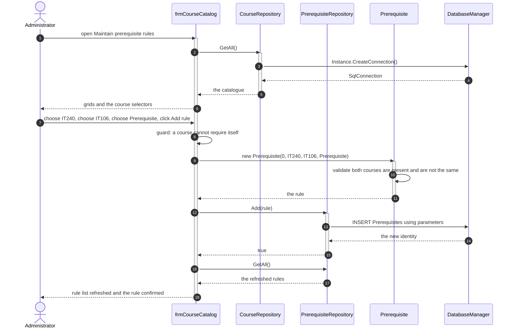

# 3 — Sequence Diagrams

**Rubric: 4 marks — correct object interaction and messages.**

Four diagrams, one for each operation that has meaningful interaction. Lifeline names are
the **real class names** from the code, which is what the "UML consistency" marks check.

---

## SD-1 — Login and role redirect

The single login screen, the authentication service, the factory that builds the right
account type, and the redirect that follows.

**The polymorphic point.** `GetProfileSummary()` and `GetDashboardTitle()` are called on a
`User` reference. The same two calls produce a student summary, an adviser summary or an
administrator summary depending only on the object that `UserFactory` built.

---

## SD-2 — Student views eligible courses and submits a plan

This diagram carries the central requirement of the business case: eligibility is
validated before a course can be taken, and the student is told which rule refused them.

---

## SD-3 — Adviser approves a plan, and the Observer pattern fires

This is the diagram that demonstrates the Observer pattern. The request changes state and
announces it; two observers react, and neither the request nor the approval screen knows
that either of them exists.

**Why this is the Observer pattern and not just a method call.** `CourseRequest` never
names `StudentNotificationService` or `AuditLogService`. It holds `List<IUserObserver>`
and calls the interface. Adding an e-mail observer would be one new class and one `Attach`
line, with no change to `CourseRequest` and no change to this screen.

---

## SD-4 — Administrator defines a prerequisite rule

---

## Consistency notes

These diagrams are what the "UML consistency" marks look at, so:

| Consistency requirement | How it is met |
|---|---|
| Lifeline names match the class diagram | Every participant above is a class or an interface from the class diagram |
| Messages match real operations | Every message is a method that exists with that name and those parameters in the code |
| Actors match the use case diagram | The person signing in, the Student, the Adviser and the Administrator are the same actors |
| The sequences match the use cases | SD-1 → UC-01, UC-02, UC-20. SD-2 → UC-09, UC-10, UC-18. SD-3 → UC-15, UC-19. SD-4 → UC-05 |

---

## EA redraw checklist

- [ ] Four sequence diagrams, one per section above
- [ ] Lifelines drawn as named rectangles using the `:ClassName` form
- [ ] **Activation bars** on every lifeline that is executing
- [ ] Messages as **solid** arrows with a filled head, ordered top to bottom
- [ ] Returns as **dashed** arrows with an open head
- [ ] `alt` / `else` fragments on SD-1 (three login outcomes) and SD-2 (blocked or eligible)
- [ ] A `loop` fragment on SD-2 for the rule loop over the catalogue
- [ ] A `Note` on SD-3 where the Observer pattern fires
- [ ] Numbering is optional, but it makes the report easier to follow
