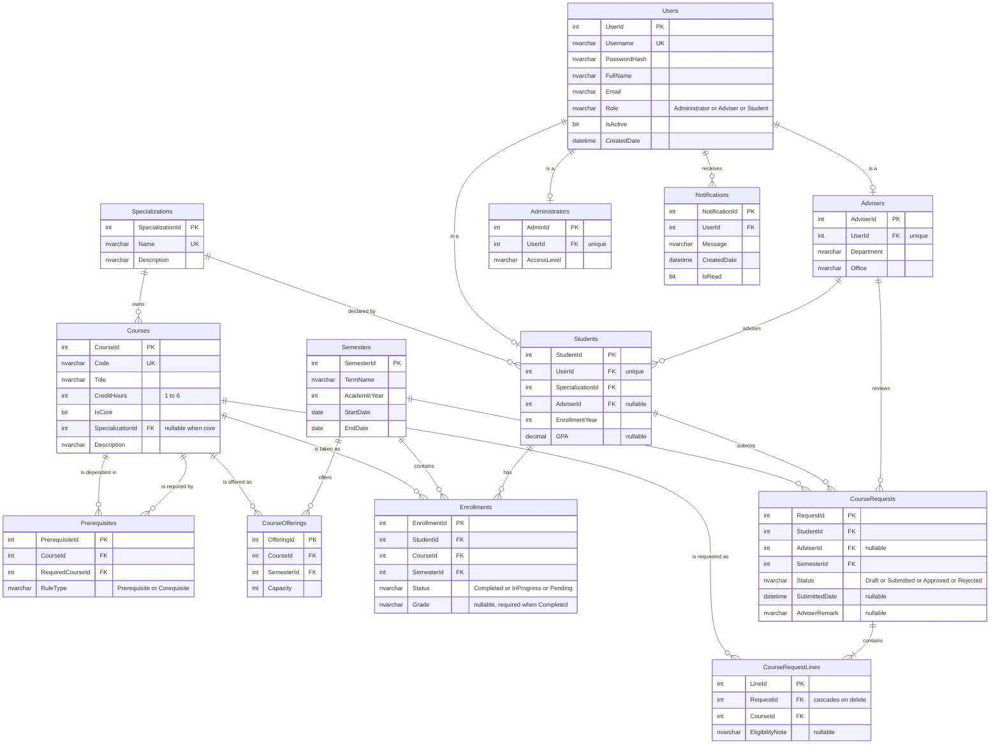

# 4 — Entity Relationship Diagram

**Rubric: part of the 10 marks for Data Layer and Database.**

13 tables in third normal form. The diagram below is generated from the real schema in
`src/SCAIS/SCAIS/Database/01_schema.sql`.

---

## 4.1 The diagram

---

## 4.2 Normalisation

| Normal form | How the schema satisfies it |
|---|---|
| **1NF** | No repeating groups and no multi-valued columns. A student's courses are rows in `Enrollments`, never a comma separated column. Every column holds a single atomic value. |
| **2NF** | Every non-key attribute depends on the **whole** primary key. Each table uses a surrogate identity primary key, and every attribute describes that whole entity. There is no table with a composite key and a partial dependency. |
| **3NF** | No transitive dependencies. `Students` stores `SpecializationId`, not the track name — the name lives once in `Specializations`. `Enrollments` stores `StudentId`, `CourseId` and `SemesterId`, never the student name, the course title or the term name. Changing a course title therefore updates one row, not every enrolment of that course. |

### Where the design is deliberately *not* normalised

`CourseRequestLines.EligibilityNote` and `CourseRequests.AdviserRemark` hold text that is
derived from the eligibility rules and from the adviser's typing. This is not a
normalisation error: the note records what the rule said **at the time of the decision**,
which is historical fact rather than derivable data. Recomputing it later would give a
different answer once the curriculum changed.

---

## 4.3 EA redraw checklist

- [ ] All 13 tables, each with its name, primary key and foreign keys
- [ ] `PK` and `FK` markers on the correct columns
- [ ] Every relationship has a cardinality at **both** ends
- [ ] `Users 1 — 0..1 Students`, `Advisers`, `Administrators` — the exclusive arc
- [ ] `Advisers 1 — 0..* Students`
- [ ] `Courses 1 — 0..* Prerequisites` drawn **twice**, once from each end, because it is a
      self relationship
- [ ] `CourseRequests 1 — 1..* CourseRequestLines` shown as an identifying relationship
      (the child cannot exist without the parent)
- [ ] A note on the diagram stating the schema is in 3NF
- [ ] The table and column names match `01_schema.sql` exactly
