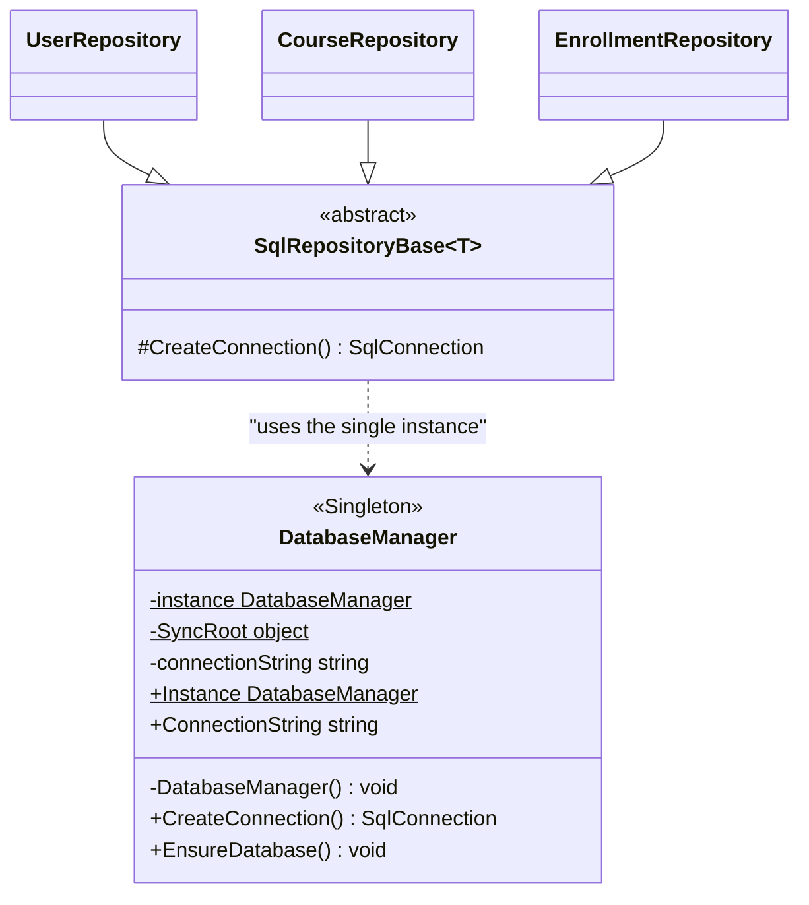
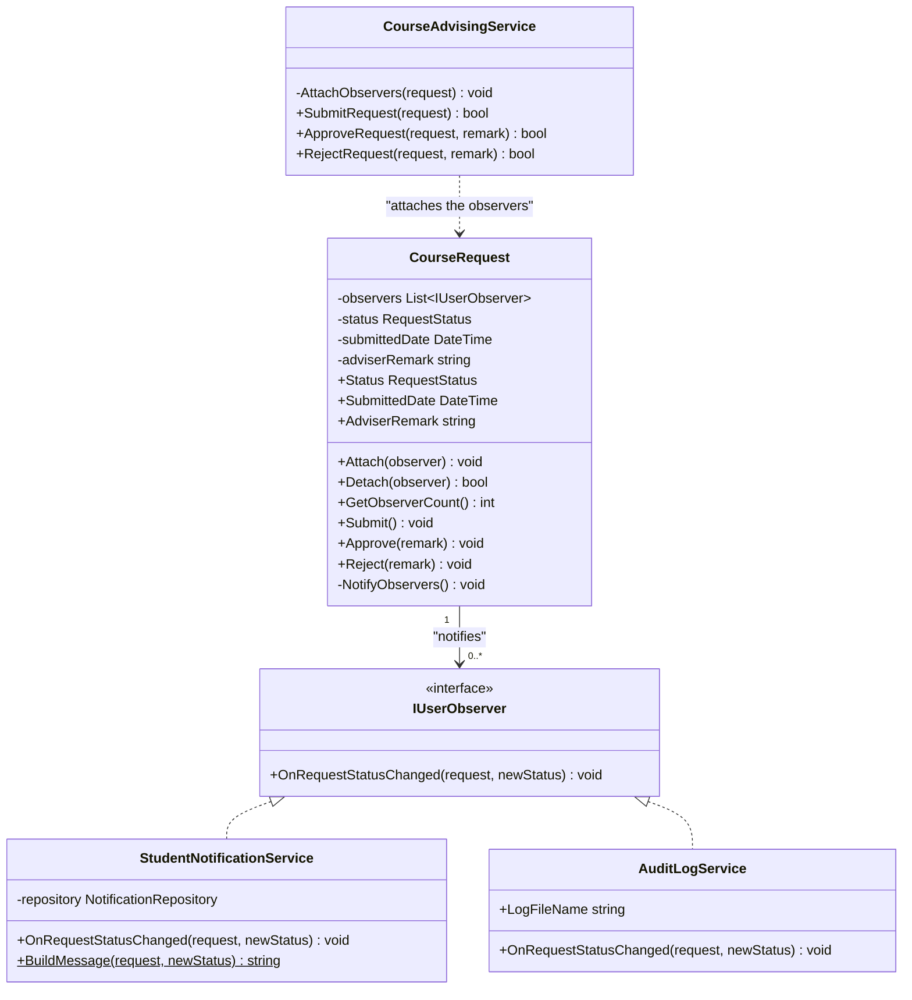
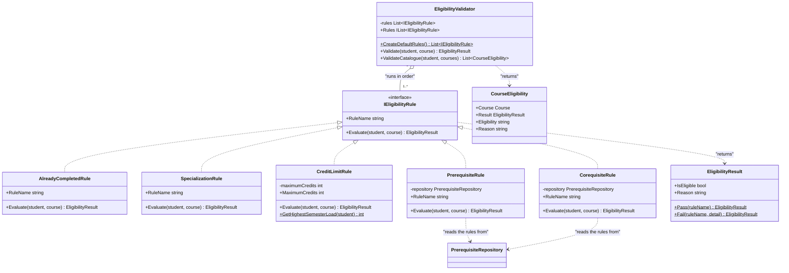

# 5 — Design Pattern Diagrams

**Rubric: 20 marks — problem, selection, UML, implementation, explanation, benefits and
limitations.**

The prose for each pattern — the problem, why it was chosen, the alternatives that were
rejected, and the benefits and limitations — is in
[`../04-design-patterns.md`](../04-design-patterns.md). This file holds the **UML
structures** and the checklist for redrawing them in EA.

Three patterns are used. The brief requires at least two and states that Singleton cannot
be the only one, so two more were added where the problem genuinely called for them.

---

## 5.1 Singleton — `DatabaseManager`

**Problem.** Several unrelated parts of SCAIS read the database at the same time. If each
built its own connection manager the application would hold several connection strings and
several open connections to the same LocalDB file, causing file-locking errors and
inconsistent reads. The system needs exactly one object that owns the connection
configuration.

| Participant | Role |
|---|---|
| `DatabaseManager` | The single instance. Owns the connection string and creates connections. |
| `SqlRepositoryBase<T>` and its subclasses | Clients. They never build a connection string themselves. |

**Why the UML is the pattern.** The private constructor and the static `instance` field are
what make it a Singleton rather than an ordinary manager. EA should show the constructor
with a `-` marker and `instance` and `Instance` with a static marker.

---

## 5.2 Observer — `CourseRequest` and its listeners

**Problem.** When an adviser approves or rejects a plan, several unrelated things must
happen at once: the student must be told, and an audit line must be written. If
`CourseRequest` called those directly, a domain class that models *a plan* would have to
know about the notification table and about logging.

| Participant | Role |
|---|---|
| `IUserObserver` | The Observer contract. Every listener implements it. |
| `CourseRequest` | The Concrete Subject. Holds the list, changes state, calls `NotifyObservers()`. |
| `StudentNotificationService` | A Concrete Observer. Writes a `Notifications` row for the student. |
| `AuditLogService` | A second Concrete Observer. Appends a line to `SCAIS-audit.log`. |
| `CourseAdvisingService` | The client that attaches the observers before a transition. |

**Why the UML is the pattern.** The subject holds a one-to-many association to the
**interface**, not to either concrete class. There is no line from `CourseRequest` to
`StudentNotificationService` or to `AuditLogService` at all — that absence *is* the
pattern, and a marker will look for it.

---

## 5.3 Strategy — the eligibility rules

**Problem.** Eligibility is not one rule. A course may require a completed prerequisite, a
concurrently taken corequisite, a credit hour ceiling, and it must not have been taken
already. Putting all of that in one method would violate single responsibility, and the
administrator's requirement to maintain the rules of the system would need a code change
for every new rule.

| Participant | Role |
|---|---|
| `IEligibilityRule` | The Strategy contract. |
| `PrerequisiteRule`, `CorequisiteRule`, `CreditLimitRule`, `AlreadyCompletedRule`, `SpecializationRule` | The five Concrete Strategies, each encapsulating one algorithm. |
| `EligibilityValidator` | The Context. Holds the strategies and runs them; knows nothing about which ones it has. |
| `EligibilityResult` | The value returned by a strategy: a verdict plus the reason. |
| `CourseEligibility` | The value returned by the context for a whole catalogue, which the grid binds to. |

**Why the UML is the pattern.** The context holds an aggregation of the **interface** and
runs them in a loop. The five concrete rules are interchangeable: adding a sixth is a new
class plus one line in `CreateDefaultRules`, and nothing else changes.

---

## 5.4 The pattern summary for the report

| Pattern | Problem it solves | Participants | Where in the code |
|---|---|---|---|
| **Singleton** | One object must own the database connection configuration | `DatabaseManager`, `SqlRepositoryBase<T>` | `DataAccess/DatabaseManager.cs` |
| **Observer** | One status change must notify several decoupled parties | `CourseRequest`, `IUserObserver`, `StudentNotificationService`, `AuditLogService` | `Domain/CourseRequest.cs`, `Interfaces/IUserObserver.cs`, `Observers/*.cs` |
| **Strategy** | The eligibility algorithm varies and must be extensible without editing the validator | `IEligibilityRule`, five rules, `EligibilityValidator` | `Interfaces/IEligibilityRule.cs`, `Business/*Rule*.cs`, `Business/EligibilityValidator.cs` |

---

## 5.5 EA redraw checklist

For **each** of the three patterns:

- [ ] A separate small class diagram, not a corner of the main class diagram
- [ ] The pattern's stereotype on the key participant (`«Singleton»`, `«interface»`)
- [ ] The participants from the table above, with their real names
- [ ] The relationship that *makes* it the pattern is visible:
      - **Singleton**: the **private** constructor and the static instance member
      - **Observer**: the association from the subject to the **interface**, and **no**
        association from the subject to either concrete observer
      - **Strategy**: the aggregation from the context to the **interface**
- [ ] The report's design pattern section references each diagram by number
- [ ] Benefits **and limitations** are written for each pattern. The limitations are worth
      2 marks per pattern and are the most commonly omitted part of the whole rubric.
