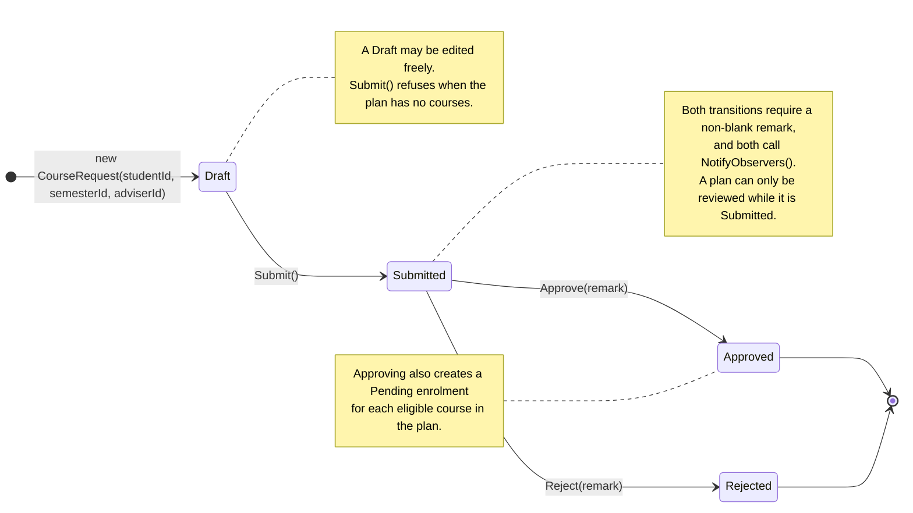

# 6 — Course Plan Lifecycle (State Diagram)

Supporting diagram. It is not separately marked, but it is what justifies the guards in
`CourseRequest` and it makes the Observer pattern's trigger point visible.

---

## 6.1 The diagram

---

## 6.2 The guards, and why they exist

| Transition | Guard | Why it is enforced |
|---|---|---|
| `Draft → Submitted` | The plan must contain at least one course | A plan with no courses asks the adviser nothing, so submitting it would only create noise in the review queue |
| `Draft → Submitted` | The current state must be `Draft` | Submitting twice would create two reviews of the same plan |
| `Submitted → Approved` / `Rejected` | A remark is required | The student reads the remark, so a decision without one tells them nothing. The database does not require it, so the rule is enforced in the domain object |
| `Submitted → Approved` / `Rejected` | The current state must be `Submitted` | A decision can only be made on a plan that is actually awaiting one |

These guards are why `CourseRequest.Status`, `SubmittedDate` and `AdviserRemark` have no
public setters. The state cannot be forced from outside; it can only be moved through the
methods that check the guards.

---

## 6.3 Where the Observer pattern fires

`NotifyObservers()` is called on all three transitions, not only on approval. That means a
student is told when their plan is **submitted** as well as when it is decided, and the
audit trail records the whole lifecycle rather than only the outcome.

---

## 6.4 EA redraw checklist

- [ ] `Draft`, `Submitted`, `Approved` and `Rejected` as states
- [ ] An initial pseudostate before `Draft` and a final state after `Approved` and
      `Rejected`
- [ ] Transition labels carrying the **operation name**, not just the event
- [ ] A note recording the guards from §6.2
- [ ] A note marking where `NotifyObservers()` fires
